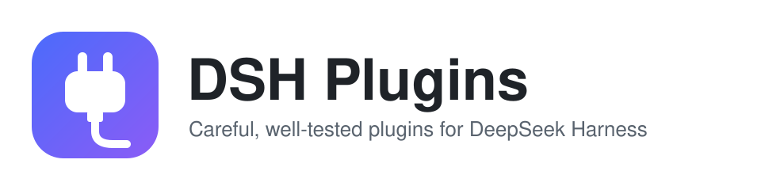

<p align="center">
  <picture>
    <source media="(prefers-color-scheme: dark)" srcset=".github/assets/banner-dark.svg">
    
  </picture>
</p>

<p align="center">
  <a href="https://github.com/kangyishuai/dsh-plugins/actions/workflows/ci.yml"></a>
  <a href="https://www.npmjs.com/search?q=%40kangyishuai%2Fdsh-"></a>
  <a href="docs/runtime/0.2.2-rc.3.md"></a>
  <a href="LICENSE"></a>
</p>

<p align="center">Plugins for <a href="https://github.com/deepseek-ai/deepseek-harness">DeepSeek Harness (DSH)</a>. Each one is an independent npm package, verified end to end against a real DSH host before release.<br><b>English</b> · <a href="README.zh-CN.md">中文</a></p>

## Plugins

| Plugin                                                                                                                          | What it does                                                                                                                                                                                                                                                                                                                                                                                                                                                                                                                                                                                                                                                       | Version                                                                                                                                      |
| ------------------------------------------------------------------------------------------------------------------------------- | ------------------------------------------------------------------------------------------------------------------------------------------------------------------------------------------------------------------------------------------------------------------------------------------------------------------------------------------------------------------------------------------------------------------------------------------------------------------------------------------------------------------------------------------------------------------------------------------------------------------------------------------------------------------ | -------------------------------------------------------------------------------------------------------------------------------------------- |
| [**session-delete**](packages/session-delete#readme)<br><sub>[screenshots](packages/session-delete/README.md#screenshots)</sub> | Really deletes sessions instead of just archiving them. Deleted sessions go to a restorable trash; the confirm dialog shows one line of impact (size · sub-sessions · running) and Enter executes it. Supports `⌘⌥⌫` for the current session, one-click clearing of a whole workspace, and chunked permanent deletion from the trash. Every action goes into an audit log, and a receipt lists anything left behind.                                                                                                                                                                                                                                               | [](https://www.npmjs.com/package/@kangyishuai/dsh-session-delete) |
| [**session-rewind**](packages/session-rewind#readme)                                                                            | Rewind a conversation in place: `Esc` `Esc` or the ↶ button next to Copy, then choose conversation-only or conversation-plus-files. Everything from the target message on is withdrawn from the model context and transcript; changed files are restored with pre-write snapshots, rescue points and a trash, and the message text/images return to the composer. A panel lists withdrawn messages, audit history, rescue points and diagnostics. The log is append-only. Bare `↑` / `↓` in the composer recalls prompts you already sent, without rewinding anything.                                                                                             | [](https://www.npmjs.com/package/@kangyishuai/dsh-session-rewind) |
| [**next-step**](packages/next-step#readme)                                                                                      | A decision card when a turn is worth continuing: a short summary of checkable facts, the question you need to settle, and 1–2 mutually exclusive next steps that name a concrete object and send exactly their own text with one click. How often it appears is a user-chosen tier (strict / balanced / eager); a withheld card is one click away and reveals the candidate already computed, with no second model call. A local review log (no message text, local only) plus a Wilson-interval report make the thresholds and wording tunable against evidence. Optionally (off by default) a grey ghost hint in the empty composer, accepted with `Tab` or `→`. | [](https://www.npmjs.com/package/@kangyishuai/dsh-next-step)           |
| [**advisor**](packages/advisor#readme)                                                                                          | On-demand second opinion: the main model decides when to consult a separately configured advisor model, which reads the whole conversation — tool calls and results included — and returns structured advice. Advisory only — it never approves, blocks or runs anything. Off by default; shadow mode, four-level budgets and a token ledger keep the extra calls visible.                                                                                                                                                                                                                                                                                         | [](https://www.npmjs.com/package/@kangyishuai/dsh-advisor)               |
| More plugins are on the way.                                                                                                    |

## Install

```bash
dsh plugin --profile desktop add @kangyishuai/dsh-session-delete
dsh plugin --profile desktop add @kangyishuai/dsh-session-rewind
```

Then restart the DSH desktop app. Each plugin's README covers usage, side effects and compatibility.

## How these plugins are built

- **Nothing destructive without a way back.** Deletion goes to a trash first. A confirm dialog states the impact: count, size, whether the session is live, and whether it can be undone. See [ADR 0002](docs/adr/0002-destructive-operations.md).
- **No hard-coded internals.** DSH is pre-release and its on-disk formats change. Plugins scan and match known patterns, and leave anything they don't recognize alone.
- **Verified on a real host.** Unit tests, plus an end-to-end GUI smoke test against a throwaway DSH home. Compatibility tables say exactly which DSH version was checked.
- **No telemetry, no hidden calls.** Plugins never phone home, and they only touch the local DSH data directory as documented. The one exception is deliberate and opt-in: `advisor` spends an extra model call, and only through the host's own LLM service, to the provider you already configured — it is off by default.
- **Plain JavaScript, no build step.** What you install is what's in the repo ([ADR 0001](docs/adr/0001-plain-js-with-jsdoc.md)).

> **Disclaimer:** this is a personal community project. It is not affiliated with or endorsed by DeepSeek. Plugins are young software, so keep backups of anything you can't lose.

## Contributing

Issues and PRs are welcome. Start with [CONTRIBUTING.md](CONTRIBUTING.md), which covers setup, commands, commit conventions and the release flow. Design notes live in [docs/](docs/README.md) (in Chinese).

## Security

Please report vulnerabilities privately. See [SECURITY.md](SECURITY.md).

## License

[MIT](LICENSE)
