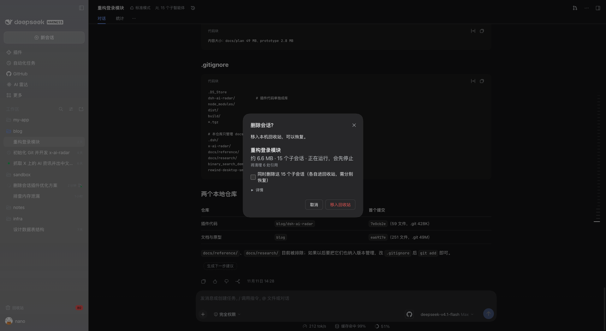

# DSH Plugins

[](https://github.com/kangyishuai/dsh-plugins/actions/workflows/ci.yml)
[](https://www.npmjs.com/search?q=%40kangyishuai%2Fdsh-)
[](docs/runtime/0.2.1-rc.5.md)
[](LICENSE)

**Careful, well-tested plugins for [DeepSeek Harness (DSH)](https://github.com/deepseek-ai/deepseek-harness).** Each one is an independent npm package. Each one is verified end to end against a real DSH host before release.

[中文](README.zh-CN.md)



## Plugins

| Plugin                                               | What it does                                                                                                                                                                                                                                                                                | Version                                                                                                                                      |
| ---------------------------------------------------- | ------------------------------------------------------------------------------------------------------------------------------------------------------------------------------------------------------------------------------------------------------------------------------------------- | -------------------------------------------------------------------------------------------------------------------------------------------- |
| [**session-delete**](packages/session-delete#readme) | Really deletes sessions instead of just archiving them. Deleted sessions go to a restorable trash, and the confirm dialog shows the plan first: size, sub-sessions, and the references that will be cleaned. Every action goes into an audit log, and a receipt lists anything left behind. | [](https://www.npmjs.com/package/@kangyishuai/dsh-session-delete) |

More plugins are on the way.

## Install

```bash
dsh plugin --profile desktop add @kangyishuai/dsh-session-delete
```

Then restart the DSH desktop app. Each plugin's README covers usage, side effects and compatibility.

## How these plugins are built

- **Nothing destructive without a way back.** Deletion goes to a trash first. A confirm dialog states the impact: count, size, whether the session is live, and whether it can be undone. See [ADR 0002](docs/adr/0002-destructive-operations.md).
- **No hard-coded internals.** DSH is pre-release and its on-disk formats change. Plugins scan and match known patterns, and leave anything they don't recognize alone.
- **Verified on a real host.** Unit tests, plus an end-to-end GUI smoke test against a throwaway DSH home. Compatibility tables say exactly which DSH version was checked.
- **No network, no telemetry.** Plugins only touch the local DSH data directory, and only as documented.
- **Plain JavaScript, no build step.** What you install is what's in the repo ([ADR 0001](docs/adr/0001-plain-js-with-jsdoc.md)).

> **Disclaimer:** this is a personal community project. It is not affiliated with or endorsed by DeepSeek. Plugins are young software, so keep backups of anything you can't lose.

## Contributing

Issues and PRs are welcome. Start with [CONTRIBUTING.md](CONTRIBUTING.md), which covers setup, commands, commit conventions and the release flow. Design notes live in [docs/](docs/README.md) (in Chinese).

## Security

Please report vulnerabilities privately. See [SECURITY.md](SECURITY.md).

## License

[MIT](LICENSE)
