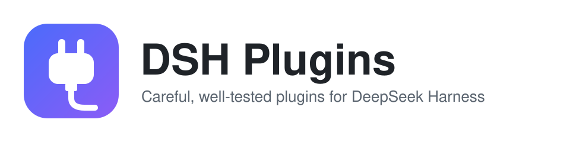

<p align="center">
  <picture>
    <source media="(prefers-color-scheme: dark)" srcset=".github/assets/banner-dark.svg">
    
  </picture>
</p>

<p align="center">
  <a href="https://github.com/kangyishuai/dsh-plugins/actions/workflows/ci.yml"></a>
  <a href="https://www.npmjs.com/search?q=%40kangyishuai%2Fdsh-"></a>
  <a href="docs/runtime/0.2.2-rc.1.md"></a>
  <a href="LICENSE"></a>
</p>

<p align="center">为 <a href="https://github.com/deepseek-ai/deepseek-harness">DeepSeek Harness (DSH)</a> 打造的插件。每个插件都是独立的 npm 包，发布前都在真实的 DSH 宿主上做过端到端验证。<br><a href="README.md">English</a> · <b>中文</b></p>

## 插件

| 插件                                                                                                                             | 做什么                                                                                                                                                                                                                                                                                                                   | 版本                                                                                                                                         |
| -------------------------------------------------------------------------------------------------------------------------------- | ------------------------------------------------------------------------------------------------------------------------------------------------------------------------------------------------------------------------------------------------------------------------------------------------------------------------ | -------------------------------------------------------------------------------------------------------------------------------------------- |
| [**session-delete**](packages/session-delete/README.zh-CN.md)<br><sub>[截图](packages/session-delete/README.zh-CN.md#截图)</sub> | 真正删除会话，而不只是归档。删掉的会话先进可恢复的回收站；确认框会先列出删除计划：体积、子会话、将要清理的引用。每次操作都写进审计日志，删完还会给一份残留回执。                                                                                                                                                         | [](https://www.npmjs.com/package/@kangyishuai/dsh-session-delete) |
| [**session-rewind**](packages/session-rewind/README.zh-CN.md)                                                                    | 就地回溯对话：`Esc` `Esc` 或用户消息旁的 ↶ 按钮，可选「仅回退对话」或「对话+文件」。目标及其后的内容从模型上下文和对话里撤回；改过的文件用写前快照+救援点+回收站还原；消息文本/图片回到输入框。回溯面板可见已撤回消息、审计记录、救援点与诊断。日志只追加；输入框里裸 `↑` / `↓` 可召回已发送的提示词，且不回溯任何东西。 | [](https://www.npmjs.com/package/@kangyishuai/dsh-session-rewind) |
| [**next-step**](packages/next-step/README.zh-CN.md)                                                                              | 需要继续时在回答下方给一张决策卡：现状摘要、需要你拍板的问题、两条互斥的下一步建议，点哪句就把哪句原样作为用户消息发出；模型判断不需要就不出卡，可在回答下方一键补生成。可选（默认关）在空输入框里给一条灰色幽灵提示，`Tab` / `→` 接受。                                                                                 | [](https://www.npmjs.com/package/@kangyishuai/dsh-next-step)           |

更多插件开发中。

## 安装

```bash
dsh plugin --profile desktop add @kangyishuai/dsh-session-delete
dsh plugin --profile desktop add @kangyishuai/dsh-session-rewind
```

装完重启 DSH 桌面版。用法、副作用和兼容性见各插件的 README。

## 这些插件怎么做

- **破坏性操作一定留后路。** 删除先进回收站。确认框会写明影响：数量、大小、会话是否正在运行、能否恢复。见 [ADR 0002](docs/adr/0002-destructive-operations.md)。
- **不写死内部实现。** DSH 还在预发布阶段，磁盘格式会变。插件按已知模式扫描和匹配，不认识的东西一律不动。
- **在真实宿主上验证。** 除了单元测试，还会在一次性的 DSH 目录里跑端到端 GUI 冒烟测试。兼容性表格写明验证过的 DSH 版本。
- **不联网，不上报。** 插件只读写本地的 DSH 数据目录，读写范围都写在文档里。
- **纯 JavaScript，没有构建步骤。** 你装上的代码就是仓库里的代码（[ADR 0001](docs/adr/0001-plain-js-with-jsdoc.md)）。

> **声明：** 这是个人维护的社区项目，与 DeepSeek 没有关联，也未获其认可。插件还比较新，重要数据请自行备份。

## 参与贡献

欢迎提 issue 和 PR。建议先读 [CONTRIBUTING.md](CONTRIBUTING.md)，里面有环境准备、常用命令、提交规范和发版流程。设计文档见 [docs/](docs/README.md)。

## 安全

请私下报告漏洞，见 [SECURITY.md](SECURITY.md)。

## License

[MIT](LICENSE)
