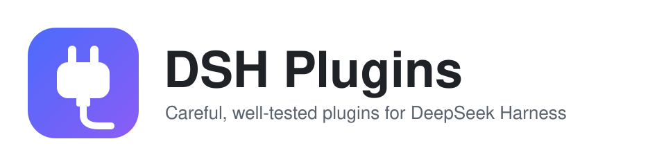

<p align="center">
  <picture>
    <source media="(prefers-color-scheme: dark)" srcset=".github/assets/banner-dark.svg">
    
  </picture>
</p>

<p align="center">
  <a href="https://github.com/kangyishuai/dsh-plugins/actions/workflows/ci.yml"></a>
  <a href="https://www.npmjs.com/search?q=%40kangyishuai%2Fdsh-"></a>
  <a href="docs/runtime/0.2.2-rc.3.md"></a>
  <a href="LICENSE"></a>
</p>

<p align="center">为 <a href="https://github.com/deepseek-ai/deepseek-harness">DeepSeek Harness (DSH)</a> 打造的插件。每个插件都是独立的 npm 包，发布前都在真实的 DSH 宿主上做过端到端验证。<br><a href="README.md">English</a> · <b>中文</b></p>

## 插件

| 插件                                                                                                                             | 做什么                                                                                                                                                                                                                                                                                                                                                                                                                      | 版本                                                                                                                                         |
| -------------------------------------------------------------------------------------------------------------------------------- | --------------------------------------------------------------------------------------------------------------------------------------------------------------------------------------------------------------------------------------------------------------------------------------------------------------------------------------------------------------------------------------------------------------------------- | -------------------------------------------------------------------------------------------------------------------------------------------- |
| [**session-delete**](packages/session-delete/README.zh-CN.md)<br><sub>[截图](packages/session-delete/README.zh-CN.md#截图)</sub> | 真正删除会话，而不只是归档。删掉的会话先进可恢复的回收站；确认框只给一行影响面（体积 · 子会话 · 是否在跑），回车即执行。支持 `⌘⌥⌫` 删除当前会话、工作区一键清空整组会话、回收站分批彻底删除。每次操作都写进审计日志，删完还会给一份残留回执。                                                                                                                                                                               | [](https://www.npmjs.com/package/@kangyishuai/dsh-session-delete) |
| [**session-rewind**](packages/session-rewind/README.zh-CN.md)                                                                    | 就地回溯对话：`Esc` `Esc` 或用户消息旁的 ↶ 按钮，可选「仅回退对话」或「对话+文件」。目标及其后的内容从模型上下文和对话里撤回；改过的文件用写前快照+救援点+回收站还原；消息文本/图片回到输入框。回溯面板可见已撤回消息、审计记录、救援点与诊断。日志只追加；输入框里裸 `↑` / `↓` 可召回已发送的提示词，且不回溯任何东西。                                                                                                    | [](https://www.npmjs.com/package/@kangyishuai/dsh-session-rewind) |
| [**next-step**](packages/next-step/README.zh-CN.md)                                                                              | 需要继续时在回答下方给一张决策卡：现状摘要（写可核查的事实）、需要你拍板的问题、**1–2 条具体到对象的下一步建议**（下一步很明确时只给一条），点哪句就把哪句原样作为用户消息发出。**出卡频率是用户选的档位**（严格 / 平衡 / 积极）；被拦下的卡一键揭示已算好的候选、不额外调模型。本机记一份复盘日志（不含消息原文）+ Wilson 区间报告，让阈值与措辞按证据调。可选（默认关）在空输入框里给一条灰色幽灵提示，`Tab` / `→` 接受。 | [](https://www.npmjs.com/package/@kangyishuai/dsh-next-step)           |
| [**advisor**](packages/advisor/README.zh-CN.md)                                                                                  | 按需的第二意见：由主模型自己决定何时徵询一个单独配置的顾问模型；顾问读整段对话（含工具调用与结果），返回结构化建议。顾问只给建议，不批准、不执行任何动作。默认关闭；shadow 模式、四级预算与 token 账本让这笔额外调用看得见。                                                                                                                                                                                                | [](https://www.npmjs.com/package/@kangyishuai/dsh-advisor)               |
| [**btw**](packages/btw/README.zh-CN.md)                                                                                          | 不打断主任务地提一个只读旁问：命令在回合进行中立即派发而不是排队；答案在 fork 出来、没有工具的只读子代理里生成，由运行期 guard 强制，因此不进对话历史。fork 复用主会话提示前缀（实测 57%–94% 走缓存，且无写缓存费用），答案按会话落盘可重开。DSH 原生右侧栏 tab 会流式显示答案并完整渲染 Markdown（主对话变窄但不被遮挡）；支持线程追问、一键转正（保留 Markdown 源码、只插草稿、绝不自动发送）与诚实的范围徽章。           | [](https://www.npmjs.com/package/@kangyishuai/dsh-btw)                       |
| [**artifacts**](packages/artifacts/README.zh-CN.md)                                                                              | 给会话加本地工件页：一个 `artifact` 工具发布自包含 HTML，时间线只留一行摘要，最新版本在右栏沙箱面板里原地刷新。版本以文件存在 DSH 数据根下，不上传任何地方。                                                                                                                                                                                                                                                                | [](https://www.npmjs.com/package/@kangyishuai/dsh-artifacts)           |
| [**projects**](packages/projects/README.zh-CN.md)                                                                                | 项目级上下文：会话按项目分组，每次请求前注入该项目的常设规则与 `MEMORY.md` 索引（全局注册、按会话求值）；一个面板里看线程、记忆、审计与待审批动作。线程带独立 worktree 与归档回收，协调器默认只提议、豆子般小的工具篮子（无 shell/写文件/删除/推送/合并），危险动作只能申请、需开关打开才可执行。不写远端仓库、不读凭据。                                                                                                   | [](https://www.npmjs.com/package/@kangyishuai/dsh-projects)             |
| [**casefile**](packages/casefile/README.zh-CN.md)<br><sub>[界面](packages/casefile/README.zh-CN.md#工作台)</sub>                 | REA 之上的循证逆向工作台：观察落成可引用的证据、引用它的结论、以及「必须挂新鲜 PASS 检查且与实现 digest 一致」才能关闭的义务。真跑五类检查（构建 / CLI / 网页截图相似度 / 进程副作用 / 项目自测 JSON），实现一变就把已关闭的义务自动重开；覆盖率、未知项、检查新鲜度没有全部对齐就不许关闭项目。导出脱敏规格包与验收报告。不做 MCP 桥、不带分析引擎、无 DRM 绕过。                                                          | [](https://www.npmjs.com/package/@kangyishuai/dsh-casefile)             |
| 更多插件开发中。                                                                                                                 |

## 安装

**从发现页安装（推荐）。** 打开 DSH 的 **插件 → 发现 → 添加索引源**，填入：

```
https://cdn.jsdelivr.net/npm/@kangyishuai/dsh-plugin-index/index.json
```

本仓库的插件就会带着简介、分类和版本列表出现在发现页里，点一下即可安装。索引在每次发版后从 npm 重建，列出来的版本一定真实存在。

**或者用命令行：**

```bash
dsh plugin --profile desktop add @kangyishuai/dsh-session-delete
dsh plugin --profile desktop add @kangyishuai/dsh-session-rewind
```

装完重启 DSH 桌面版。用法、副作用和兼容性见各插件的 README。

## 这些插件怎么做

- **破坏性操作一定留后路。** 删除先进回收站。确认框会写明影响：数量、大小、会话是否正在运行、能否恢复。见 [ADR 0002](docs/adr/0002-destructive-operations.md)。
- **不写死内部实现。** DSH 还在预发布阶段，磁盘格式会变。插件按已知模式扫描和匹配，不认识的东西一律不动。
- **在真实宿主上验证。** 除了单元测试，还会在一次性的 DSH 目录里跑端到端 GUI 冒烟测试。兼容性表格写明验证过的 DSH 版本。
- **不上报，没有偷偷的请求。** 插件不向任何服务上报，也只按文档读写本地的 DSH 数据目录。唯一的例外是显式选择加入的 `advisor`：它会多花一次模型调用，而且只走宿主自己的 LLM 服务、只发给你已经配置好的 provider —— 默认关闭。
- **纯 JavaScript，没有构建步骤。** 你装上的代码就是仓库里的代码（[ADR 0001](docs/adr/0001-plain-js-with-jsdoc.md)）。

> **声明：** 这是个人维护的社区项目，与 DeepSeek 没有关联，也未获其认可。插件还比较新，重要数据请自行备份。

## 参与贡献

欢迎提 issue 和 PR。建议先读 [CONTRIBUTING.md](CONTRIBUTING.md)，里面有环境准备、常用命令、提交规范和发版流程。设计文档见 [docs/](docs/README.md)。

## 安全

请私下报告漏洞，见 [SECURITY.md](SECURITY.md)。

## License

[MIT](LICENSE)
