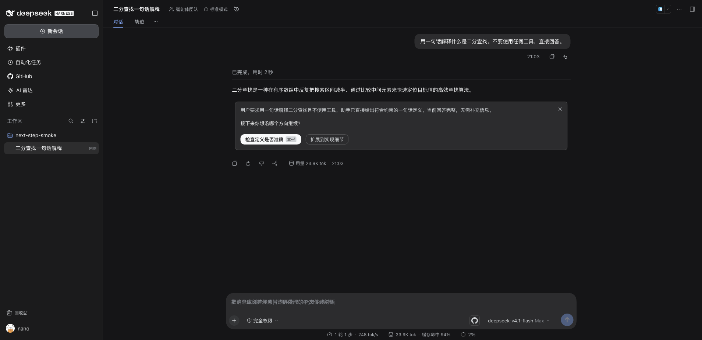
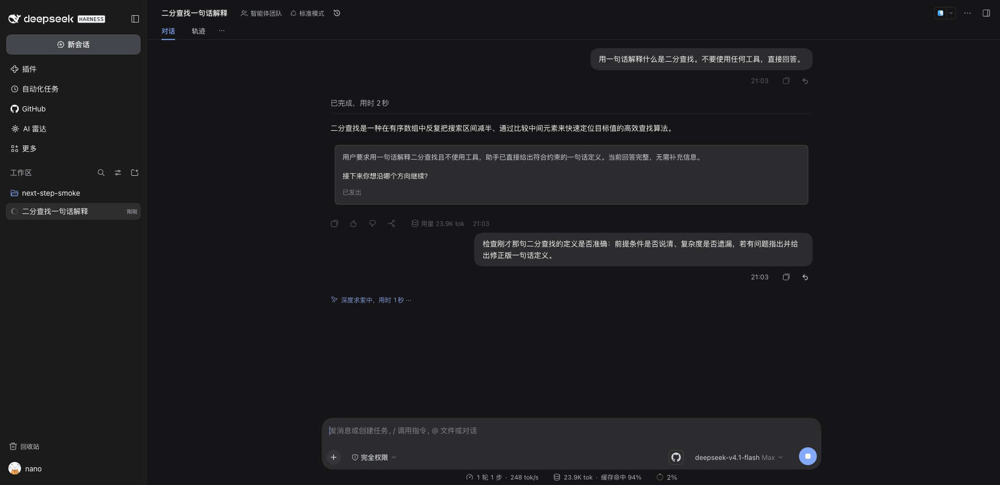

# @kangyishuai/dsh-next-step

> A next-step decision card for DeepSeek Harness: after every completed answer, a compact card under it shows where the conversation stands, the question you need to settle, and two mutually exclusive proposals. Click one and its full text is sent as your user message. Optionally — off by default — a grey ghost hint in the empty composer offers the next prompt, accepted with `Tab` or `→`.

[](https://www.npmjs.com/package/@kangyishuai/dsh-next-step) [](#compatibility) [](./LICENSE)

[中文](./README.zh-CN.md)

Unofficial plugin for [DeepSeek Harness (DSH)](https://github.com/deepseek-ai/deepseek-harness). Not affiliated with DeepSeek.

> **Status: early.** Verified against the current target DSH version — see the [Compatibility](#compatibility) table. Both faces sit on host seams that are not public API, so a DSH upgrade can silently disable them (read [Side effects & risks](#side-effects--risks) first). Young software: keep your own notes of anything you would hate to lose.



## What it does

- **A card under every completed answer.** When a turn ends normally, the plugin makes one extra model call and appends a decision card below the answer: a one-to-three sentence **summary** of the conversation state (folded to two lines, with an expand/collapse control when it is longer), one **question** that names the decision you have to make, and **two pills** for two mutually exclusive directions. Each pill has a short label (up to 20 characters); the full instruction behind it is what gets sent.
- **One click is one user message.** Clicking a pill puts its full text into the composer and submits it through the same path as pressing Enter yourself — not by faking a session event. An idle session sends immediately; if a turn is already running, the text is queued exactly like a typed message.
- **It stays.** Cards and decisions are appended to the session log as plugin records and folded by a session projection, which is the only source of truth. A page reload, a session switch or an app restart brings them back; the client keeps no separate state.
- **Resolved, not removed.** After you click, the card stays in the transcript but becomes read-only: summary and question remain, the pills disappear (a sent card may add a grey “sent” line). Cards from earlier turns are always read-only, so at most one card is interactive at a time. The ✕ in a card's corner dismisses it without sending anything.
- **Ghost hint in the composer (off by default).** The same model call also produces one next prompt. With the ghost face enabled, an empty idle composer shows it as grey, placeholder-style text. `Tab` or `→` accepts it into the draft (undoable with `Ctrl+Z`), `Esc` clears the current suggestion, typing makes it disappear, and it stays hidden while the composer holds a draft, an attachment, an `@` reference or a slash command. The ghost is not draft content, so pressing Enter on an otherwise empty composer sends nothing.
- **Two faces, one call.** Card and ghost are produced together by a single model call — turning the ghost on costs no additional requests.
- **Switches that actually stop requests.** `card` (default on) and `ghost` (default off) are separate switches; the global `enabled` switch off means no generation request at all, not just a hidden UI. A pause and a per-session card budget (`maxCardsPerSession`) stop new cards too. Cards already in the log stay readable.

## Cost & model calls

- One extra model call per trigger, on the model the session's agent is currently using (falling back to the default model selection), billed to your own provider quota.
- The call times out after 20 s. Failures, rate limits and malformed JSON are silent: no card, no dialog — only a counter in the plugin's diagnostics. Malformed output is dropped without writing a record.
- No other network access, no telemetry.

## Side effects & risks

- **Appends plugin records to the session log.** One card record per generated card, one decision record per click or dismissal. Nothing is edited or deleted; uninstalling stops rendering them, but the records stay in the log.
- **Spends model quota** on every completed turn while the card face is on — see [Cost & model calls](#cost--model-calls).
- **A click overwrites the composer draft.** Sending the pill text goes through the composer shell (`setDraft`, then `submit`), which replaces whatever was in the draft. To protect you, both pills are **disabled while the composer holds any draft**, and the hover hint asks you to clear it first.
- **What is sent is a normal user message.** It enters the model context and is visible in the transcript exactly as if you had typed it.
- **Private host seams.** The card renders through `conversation.chat.turnTail`; state comes from a host session projection read via `useProjection`; click-to-send uses the composer shell (`setDraft` / `submit`, waiting for the draft to settle before submitting); the ghost uses `conversation.input.overlay` and the host's placeholder DOM. These are internal, untyped and unversioned: a DSH upgrade can make the card, the send path or the ghost stop working **silently**. The plugin degrades instead of breaking a session, but after an upgrade run `pnpm probe:runtime` and the smoke suites, and check diagnostics.
- **The ghost is coupled to the host placeholder DOM**, which is why it ships off by default; if that DOM changes, the hint can simply disappear.
- **Silent failure is by design.** “No card appeared” is not an error dialog; look at the diagnostics counters before filing a bug.
- **No plugin data directory and no workspace files.** Everything lives in the existing session log; nothing is written under `DSH_HOME` besides the session itself.
- **Subagent sessions never get cards**, and only normally completed turns are eligible.

## Install

```bash
dsh plugin --profile desktop add @kangyishuai/dsh-next-step
```

To run the working tree instead of a published version, pack it first — `link:` installs do not work (the host's `@deepseek-ai/*` resolution only covers packages whose real path is inside the profile):

```bash
cd packages/next-step
pnpm pack --pack-destination /tmp
dsh plugin --profile desktop add /tmp/kangyishuai-dsh-next-step-*.tgz
```

Re-run `pnpm pack` + `add` after changing the code. The plugin has a host half, so restart the DSH desktop app and refresh the page.

## Usage

**The card.** It appears under the last answer once that turn has completed, and it never steals focus. Each pill carries its short label; click it to send the full instruction. If the summary is folded, use the small expand button to read it all. ✕ dismisses the card; earlier cards are read-only for reference.

**The ghost hint.** Turn the ghost face on in the plugin settings. With an empty, idle composer you see the latest card's next prompt in grey, aligned with the host placeholder. `Tab` or `→` accepts it — the text lands in the draft and stays undoable. `Esc` clears it for this suggestion, and the first typed character hides it. It only ever edits the draft: it does not send, and it does not bind Enter.

**Where the switches are.** The plugin's settings expose the two faces (`card` / `ghost`), the global switch, the pause and the per-session budget. The global switch off stops requests entirely, not just rendering.

## Settings & diagnostics

Settings → **General** → “Next-step suggestions” is one row with everything you need to control it:

- **Enable the plugin** — the global switch. Off means **no generation request at all**, not a hidden UI.
- **Decision card under the answer** / **Ghost hint in the composer** — one switch per face.
- **Cadence** — “Pause for 1 hour” / “Resume”.
- **Per session, at most N cards** — the budget (`maxCardsPerSession`, clamped to 0–1000).
- **Diagnostics** — generated / failed / skipped / in-flight counters, the last error, and a Refresh button.

The row writes the same `$DSH_HOME/next-step.settings.json` that the host re-reads (1 s cache) before every generation, so a change applies on the next turn — no restart. If the row is missing because a host seam moved, editing the file still works.

## When no card appears

| Situation                                                                                         | What happens                                                               |
| ------------------------------------------------------------------------------------------------- | -------------------------------------------------------------------------- |
| The turn was stopped, errored, or produced no text                                                | No card: only normally completed turns are eligible.                       |
| Subagent session                                                                                  | No card, by design.                                                        |
| Global switch off                                                                                 | No request is made at all; existing cards remain in the transcript.        |
| Paused, or the session's card budget (`maxCardsPerSession`) used up                               | No new card; existing cards stay.                                          |
| A card or a decision already exists for that turn                                                 | One card per turn; no duplicates.                                          |
| Model call failed, timed out (20 s), was rate-limited, bad JSON                                   | Silent; only a diagnostics counter goes up.                                |
| The reply is still streaming                                                                      | Nothing is rendered for the turn until it ends.                            |
| The composer already has a draft                                                                  | The card is visible but the pills are disabled until the draft is cleared. |
| Ghost face on, but the composer is not plain (draft, attachment, `@`, `/`, or a non-idle session) | The hint stays hidden.                                                     |

## Known limitations

- **The card is attached to the composer area**, not to the transcript. It renders in the composer's overlay layer so it is visible without scrolling; the trade-off is that it reads as part of the input box rather than as a block inside the conversation (ADR 0009 §4).
- **Exactly two proposals.** Every card has two options that must point in different (mutually exclusive) directions.
- **The `⌘↵` / `Ctrl+↵` keycap on the primary pill is decorative.** v1 does not bind the shortcut; it is a visual hint only.
- **No cross-device sync.** Cards and decisions live in the local session log of the machine that generated them.
- **No cards in subagent sessions**, and none for interrupted or empty turns.
- **The ghost only offers the latest card's next prompt**, and only when the composer is empty and idle.
- **The card text is model output.** The plugin validates the shape (two options, distinct stances, label length) but does not rewrite the wording.



## Compatibility

| DSH version | Status                                                                                                                                                                                                                                                                                                                                                                                                                                      |
| ----------- | ------------------------------------------------------------------------------------------------------------------------------------------------------------------------------------------------------------------------------------------------------------------------------------------------------------------------------------------------------------------------------------------------------------------------------------------- |
| 0.2.2-rc.1  | Web composition verified end-to-end on 2026-11-10 (`pnpm smoke:next-step`: 50 passing assertions + 1 skipped settings-page check; real host + real model calls); 67 unit tests; runtime probe 60/60. Desktop real-machine regression verified with `pnpm smoke:next-step-desktop` (`--require`: 9 passing + 1 skip; `--deep`: 19 passing + 2 skips, including a real click that sends a user message). Other DSH versions are not verified. |

The plugin declares no `engines.dsh` and no `@deepseek-ai/*` peer range: DSH is pre-release and semver ranges over prereleases are unreliable (see [ADR 0005](../../docs/adr/0005-dsh-version-compatibility.md)). Treat the table as the compatibility statement. After a DSH upgrade run `pnpm probe:runtime`, `pnpm smoke:next-step` and `pnpm smoke:next-step-desktop`, then check the plugin's diagnostics.

## Development

```bash
pnpm test                     # unit tests (host generation gates, projection, RPC, client helpers)
pnpm verify                   # repo-wide gates
pnpm smoke:next-step          # temp DSH home + real GUI end to end (needs dsh, ego-browser, model credentials)
pnpm smoke:next-step-desktop  # desktop (Electron) read-only; --require for release gates; --deep adds send-path e2e
```

Test layers, assertions and the manual GUI checklist: [docs/testing/next-step.md](../../docs/testing/next-step.md) (Chinese, like the rest of the repository docs). Design notes: [ADR 0009](../../docs/adr/0009-next-step-architecture.md).

## License

MIT
