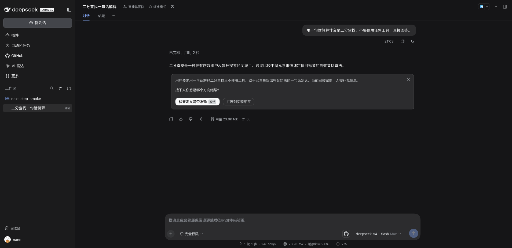
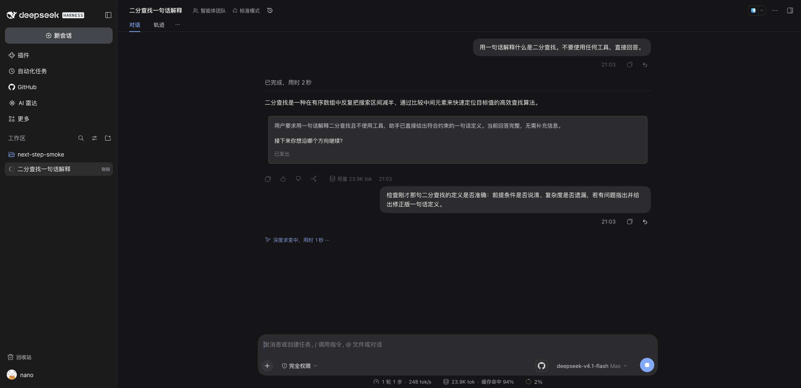

# @kangyishuai/dsh-next-step

> DeepSeek Harness 的「下一步决策卡」：一轮值得继续的回答之后，给一张小卡片，写清对话现状、需要你拍板的问题，以及 1–2 条互斥的下一步建议；点哪一句，就把那句**原样**作为用户消息发出（所见即所发）。**出卡频率由你选**（严格 / 平衡 / 积极）；被档位拦下时，最新回答下方有一键按钮可以**揭示已经算好的候选**，不额外调一次模型。它还会在本地记一份**复盘日志**，让阈值、措辞和按钮可以按证据调，而不是凭手感。可选（默认关）在空输入框里给一条灰色幽灵提示，`Tab` / `→` 接受。

[](https://www.npmjs.com/package/@kangyishuai/dsh-next-step) [](#兼容性) [](./LICENSE)

[English](./README.md)

非官方插件，与 DeepSeek 无关。面向 [DeepSeek Harness (DSH)](https://github.com/deepseek-ai/deepseek-harness)。

> **状态：早期。** 已针对当前目标 DSH 版本验证——见[兼容性](#兼容性)表格。卡片与幽灵提示都依赖宿主**私有 seam**，DSH 升级可能让它们静默失效（先读[副作用与风险](#副作用与风险)）。插件还年轻，别把重要内容只留一份在这里。



## 它做什么

- **有得继续就出卡——多频繁由你定。** 一轮正常结束后，插件额外调用一次模型，让模型把这一轮打成三档（`must` / `could` / `no`，提示词里明写「拿不准一律判 `could`」）。设置里的**出卡频率**决定显示哪几档：**严格**（只出 `must`）、**平衡**（默认，`must` + `could`）、**积极**（三档全出，含 `no`，校准用实验档）。卡片内容总是会算出来，档位只决定要不要显示；值得时在回答下方追加一张决策卡——一到三句**现状摘要**（超过两行折叠，带「展开 / 收起」小按钮）、一句点名要你拍板的**提问**，以及 **1–2 粒互斥方向**的胶囊（下一步很明确时就只给一粒，不凑数）。胶囊上就是点击后**原样发出**的那句话：**2–20 字、动词开头、必须含对话里的具体对象**（文件名 / 命令 / 参数 / 版本号 / PR 号）——「检查定义是否准确」这类放到哪一轮都成立的按钮会被直接丢掉，一条都不剩就整卡不出。
- **点一下就是一条用户消息。** 点胶囊会把它自己那行文本填入输入框，并走和手动回车**同一条提交链**发出——不是伪造会话事件。空闲会话立即发送；如果已有回合在跑，就和你打字一样排进队列。
- **刷新也不丢。** 卡片和决策以插件记录的形式追加进会话日志，由宿主的 session projection 折叠，这是唯一的数据来源。刷新页面、切换会话、重开应用都还在；客户端不另存状态。
- **只读保留，不是消失。** 点过之后卡片仍留在对话里，但变成只读：摘要和提问保留，两粒胶囊换成**你点的那一粒的选中态**（✓ + 那句话），后面跟一行灰字「已发出」。更早轮次的卡一律只读，所以任何时刻最多一张卡可交互。卡片右上角的 ✕ 可以收掉这张卡，不发送任何东西。
- **输入框幽灵提示（默认关）。** 同一次模型调用还会产出一条「下一句提示」。打开 ghost 面后，空且空闲的输入框里会以灰色、和宿主 placeholder 同字号同基线的样子显示它。`Tab` / `→` 接受进草稿（`Ctrl+Z` 可撤销），`Esc` 清除本次建议，开始打字就消失；输入框里有草稿、附件、`@` 引用或斜杠命令时隐藏。幽灵提示**不是草稿内容**，所以空框按 Enter 仍然什么都不会发。
- **两个面，一次调用。** 卡片和幽灵提示由同一次模型调用一起产出，打开 ghost 不会多花请求。
- **被拦下的卡一键可得，而且免费。** 被档位拦下的回合照样有「生成下一步建议」按钮；点它**揭示已经算好的候选**——不再调第二次模型、不用等 20 秒。只有这一轮压根没生成过候选（调用失败或超时）时才会真的再调一次。点这个按钮本身也是「档位拦掉了用户想要的卡」最硬的证据。
- **本地复盘日志，让调参有证据。** 每个合格回合往 `<dataRoot>/next-step/events.jsonl` 追加一行：哪道闸决定的、三档判定、耗时、token、你后来对这张卡做了什么（点了 / 关了 / 无视 / 自己打了下一条 / 揭示了它），以及卡片有没有真的进过视口。不上传，**也从不写你的消息原文**——只留长度、延迟，以及跟胶囊重合了几个具体对象。设置页可以生成一份 Markdown 报告（保留最新 20 份），样本不够时报告只列计数、不给结论（门槛：80 个回合 / 25 张卡）。
- **开关是真的能停。** `card`（默认开）与 `ghost`（默认关）是分开的两个开关；全局开关关闭后**不再发起生成请求**，不是只把 UI 藏起来。另有暂停和每会话卡片预算（`maxCardsPerSession`）限制新卡。已经写进日志的卡仍然可读。

## 成本

- 每次触发多一次模型调用，用会话所在智能体当前的模型（取不到时回退到默认模型选择），**占用你自己的 provider 额度**。
- 这次调用 20 秒超时。其它失败、限流、JSON 不合法都**静默**：不出卡、不弹框，只在插件诊断里加计数。**超时 / 被取消**单独计数（`aborted`，并在「最近跳过」写明 `generation timeout after 20s`），补生成按钮也会显示「生成超时或被取消」，所以这一类事后可诊断。不合法输出直接丢弃，不写记录。
- 模型判成 `no`（或判 `could` 而你选的是严格档）时不显示卡，但**这次调用已经发生**：档位省的是界面噪音，不是 token。事后揭示也不会再花一次调用。想看模型给出的理由，去设置页诊断里的「最近跳过」。
- 复盘日志是本机 append-only 文件，2 MB 滚动（`events.jsonl` + 一份 `.1` 历史）。里面没有消息原文；默认开启，可在设置里关掉（「本地采集与复盘数据」）。
- 除此之外不联网，不上报。

## 副作用与风险

- **往会话日志追加插件记录。** 每张卡一条 card 记录，每次点击或收起一条 decision 记录；不修改、不删除任何已有内容。卸载后不再渲染，但记录仍留在日志里。
- **消耗模型额度**：只要 card 面开着，每轮完整回答都会多一次调用，见[成本](#成本)。
- **点胶囊会覆盖输入框草稿。** 发送走的是宿主 composer shell（`setDraft` 后再 `submit`），会替换草稿内容。为避免误覆盖，**草稿非空时两粒胶囊都禁用**，hover 提示会让你先清空输入框。
- **发出去的就是普通用户消息。** 它进入模型上下文、出现在对话里，和你自己打字完全一样。
- **依赖宿主私有 seam。** 卡片渲染走 `conversation.chat.turnTail`；状态来自宿主 session projection（客户端用 `useProjection` 读）；点击发送走 composer shell 的 `setDraft` / `submit`（提交前等草稿落定）；幽灵提示走 `conversation.input.overlay` 和宿主 placeholder 的 DOM。这些都没有类型、没有版本契约：DSH 升级可能让卡片、发送链或幽灵提示**静默失效**。插件会降级而不是弄坏会话，但升级后请跑 `pnpm probe:runtime`、两个冒烟套件，并看诊断。
- **幽灵提示和宿主 placeholder DOM 绑在一起**，这也是它默认关的原因；宿主改了那块 DOM，它就只是不显示了。
- **失败静默是设计。**「没出卡」不是错误弹窗；先看诊断计数再判断是不是 bug。超时与取消是唯一值得单独知道的例外：它们会被标成自己的原因，而不是混进笼统的失败——之前正因为中止无痕，一次「没出卡」完全没法定位。
- **会在数据根下写两样东西。**（a）现有会话日志里每张生成的卡多一条记录——被抑制的候选也会记（`shown: false`），所以每个合格回合最多多一条小记录；（b）`<dataRoot>/next-step/events.jsonl`（复盘日志，2 MB 滚动），以及你点「生成报告」时的 `report-*.md`（保留最新 20 份，更早的在**这个插件目录内**删除）。**日志里不写消息原文**，也不会有任何东西离开本机。
- **子代理会话不出卡**，被停止、报错或没有文本的回合同样不出卡。

## 安装

```bash
dsh plugin --profile desktop add @kangyishuai/dsh-next-step
```

如果要用工作区里的代码而不是发布版，先打包再装——`link:` 装法不行（宿主的 `@deepseek-ai/*` 解析只覆盖真实路径位于 profile 内的包）：

```bash
cd packages/next-step
pnpm pack --pack-destination /tmp
dsh plugin --profile desktop add /tmp/kangyishuai-dsh-next-step-*.tgz
```

改完代码要重新 `pnpm pack` + `add`。插件带宿主半，装完重启 DSH 桌面版并刷新页面。

## 用法

**卡片。** 这一轮正常结束后出现在最后一条回答下方，不抢焦点。胶囊上就是点击后原样发出去的那句话；摘要折叠时用小小的展开按钮看全文。✕ 收掉卡片；更早的卡保持只读，供回看。

**键盘。** 卡片可交互、输入框为空、会话空闲时，按 `⌘↵` / `Ctrl+↵` 直接发送 primary 胶囊（和鼠标点击走同一条链）。输入框里有草稿、附件、`@`/`/` 菜单开着或已有回合在跑时，这个键仍归宿主的 Queue/Steer 语义，插件不抢。

**没出卡怎么办。** 没出卡有两种不同的原因：一种是被档位拦下（模型判 `no`，或判 `could` 而你选的是严格档）——这时卡片**已经算好了，只是没显示**；另一种是压根没生成（暂停、排队、预算、超时、输出不合法）——这时没有任何候选。两种情况下最新回答下方都会出现一行「生成下一步建议」：被档位拦下的，点它就是**揭示已有候选，瞬时出卡、不再调模型**；只有没有候选时才会真的重新调一次模型。所以「我觉得该出卡却没出」时：先看设置页诊断的「最近跳过」；想立刻要一张，直接点那个按钮。

**幽灵提示。** 在 设置 → **下一步建议** 里打开 ghost 面。输入框空且空闲时，最新一张卡的「下一句提示」以灰色出现，和宿主 placeholder 对齐。`Tab` 或 `→` 接受——文本进入草稿，仍可撤销。`Esc` 清除本次建议，输入第一个字符也会让它消失。它只改草稿：不发送，也不抢 Enter。

**开关在哪。** 设置 → **下一步建议**（独立分节）里有 card / ghost 两个面、全局开关、暂停，以及每会话预算。全局开关关闭后连请求都不发，不只是不显示。

## 设置与诊断

设置 → **下一步建议**（独立分节）就是一整页控制项：

分节首屏是**三行**（启用 / **出卡频率**（严格 / 平衡 / 积极，可直接切）/ 决策卡开关），其余收进默认收起的 **「更多设置」**：

- **本地采集与复盘数据** —— 复盘日志开关（默认开）。
- **输入框里的幽灵提示** —— 第二个面的开关（默认关）。
- **生成节奏** —— 「暂停 1 小时」/「恢复生成」。
- **每会话最多 N 张卡** —— 预算（`maxCardsPerSession`，夹在 0–1000，默认 120）。只统计**出过**的卡，被抑制的候选不占预算。
- **回顾** —— 四个关键数字（出卡率 / 点击率 / 忽略率 / 漏判）+ 样本够时的一句话判读 + **「生成报告」**按钮，报告写在日志旁边。
- **诊断** —— 已生成（含未显示数）/ 失败 / 已中止 / 跳过 / 在途计数、**最近一次没出卡的原因**（模型判断不需要 / 排队 / 暂停 / 预算 / 失败 / 超时 / 取消，附模型给的理由）、最近错误、**运行时版本 + 构建哈希**、刷新按钮。`nextStep/diagnostics` 同样返回 `version` / `buildHash` / `buildFiles` / `packagePath` 与 `lastSkip`，所以运行中的构建可以和 `dsh plugin list` 或 npm 上的 tarball 对照，不需要翻启动日志。注意：`buildHash` 覆盖 `package.json`，而 pnpm 在 `file:` 安装时会重写它——那种情况要和 **profile 里已安装的那一份**比，别拿仓库的哈希去对（详见 [docs/testing §4.5](../../docs/testing/next-step.md)）。

关闭总开关后，卡片 / 幽灵 / 暂停 / 预算 / 诊断这些依赖项会**整段隐藏**，只留总开关和一行说明——关掉就是关掉，不会让人以为还有东西在跑；重新启用时这些开关的取值都还在。

这一行写入的就是宿主每次生成前重读（1s 缓存）的 `$DSH_HOME/next-step.settings.json`，所以改完下一轮就生效、不用重启；万一宿主 seam 变了导致这一行不显示，直接改文件同样有效。

## 什么情况下不出卡

| 情况                                                         | 表现                                                                       |
| ------------------------------------------------------------ | -------------------------------------------------------------------------- |
| 回合被停止、报错，或没有文本                                 | 不出卡：只有正常结束的回合才有资格。                                       |
| 子代理会话                                                   | 按设计不出卡。                                                             |
| 全局开关关闭                                                 | 完全不发请求；已有卡片仍然留在对话里。                                     |
| 已暂停，或用完该会话的卡片预算（`maxCardsPerSession`）       | 不出新卡；已有卡片保留。                                                   |
| 该轮已经有 card 或 decision 记录                             | 一轮最多一张卡，不重复。                                                   |
| 模型判 `no`，或判 `could` 而你选的是严格档（`shown: false`） | 候选已落库但不显示；点补生成按钮**免费揭示**。诊断里「最近跳过」写明理由。 |
| 模型调用失败、限流、JSON 不合法                              | 静默；只有诊断计数增加。                                                   |
| 生成**超时（20 秒）或被取消**                                | 计入 `aborted`；「最近跳过」写明是哪一种，补生成按钮也会显示。不弹框。     |
| 回答还在流式输出                                             | 该轮结束前槽位不渲染。                                                     |
| 输入框里已有草稿                                             | 卡片照常显示，但胶囊禁用，直到清空草稿。                                   |
| ghost 开着，但草稿、附件、`@`、`/` 或输入状态不满足条件      | 提示隐藏。                                                                 |

## 已知限制

- **卡片排在回答下方**（`conversation.chat.turnTail`），不在输入区。答完后它就在最后一条回答下面，不用滚动；更早轮次的卡随对话历史一起滚动（取舍见 ADR 0009 §4）。
- **有排队消息时不出卡。** 如果你已经排了 2 条以上待发送消息，这一轮就跳过生成（官方 action cards 用同一条规则）；插件本身不会排队或代发任何东西。
- **建议 1–2 条。** 方向必须互斥；下一步很明确时只给一条，不凑数。
- **`⌘↵` / `Ctrl+↵` 只在「输入框干净 + 会话空闲 + 卡片可交互」时接管。** 其它时候这个组合仍是宿主的 Queue/Steer 互补发送；插件不抢占。
- **不做跨设备同步。** 卡片和决策只存在生成它的那台机器的本地会话日志里。
- **子代理会话不出卡**，被中断或没有文本的回合也不出。
- **幽灵提示只给最新一张卡的下一句**，且只在输入框为空、会话空闲时出现。
- **卡片文字来自模型。** 插件会校验形状（1–2 条选项、方向互斥、label 2–20 字且含具体对象），超长/空话的单条会被丢掉（必要时先让模型修一次格式），但不改写措辞。
- **复盘要等样本。** 少于 80 个合格回合或 25 张卡时，报告只列计数并明写「样本不足」——一两天几十条数据得出的结论只会是噪声。
- **点击发出去的就是按钮文本**，不再有「按钮短、背后另有一段长指令」的隐藏层：旧版本卡片记录里残留的 `text` 字段会被忽略。



## 兼容性

| DSH 版本   | 状态                                                                                                                                                                                                                                                                                                                                                                                                                                                                                                                                                                                                                                                                                                                                                                                                                                                                                                                                                                                                                                                                                 |
| ---------- | ------------------------------------------------------------------------------------------------------------------------------------------------------------------------------------------------------------------------------------------------------------------------------------------------------------------------------------------------------------------------------------------------------------------------------------------------------------------------------------------------------------------------------------------------------------------------------------------------------------------------------------------------------------------------------------------------------------------------------------------------------------------------------------------------------------------------------------------------------------------------------------------------------------------------------------------------------------------------------------------------------------------------------------------------------------------------------------ |
| 0.2.2-rc.3 | **0.4.1**（2026-11-14）：修一个静默失效。卡片是**投影晚到**的（回合尾部先挂载、`status` 先变 `interactive`，卡片随后才从投影进来），而登记 `⌘↵` 的 effect 只依赖 `[sessionId, status]`，于是晚到的卡片永远登记不上：卡片看着可点、点胶囊也正常，`⌘↵` 却什么都不做（只在「重挂载那一刻卡片已在投影里」时能用，所以时灵时不灵）。修法是把「卡片可见 / 有候选」纳入 effect 依赖。验证：新增 `test/client-card-shortcut.test.js`（迷你 hooks 运行时驱动真实 client 源码，覆盖晚到卡、一粒 / 两粒、草稿非空、未揭示、已决策），去掉修复即红；真机上「晚到约 2.3s 的两粒卡」按 `⌘↵` 成功发出 primary 胶囊并转 `sent`；0.4.0 上同样条件下晚到的**一粒**卡同样不接管。顺带修了两份 README 兼容性表的表头/分隔行错位。                                                                                                                                                                                                                                                                                                                                                                        |
| 0.2.2-rc.3 | **0.4.0**（2026-11-14）：卡片这一面变成**可调**且**可度量**。模型不再用一个 boolean，而是把回合打成三档（`must` / `could` / `no`），设置里选出卡频率（**严格 / 平衡（默认）/ 积极**）。被档位拦下的卡仍会存下候选，点一下**揭示**它——不再第二次调模型；只有压根没有候选的回合才真的重新生成。解析变宽容（超长文本截断、单条不合格只丢这一条）+ 一次修复调用，一个字段超长不再让整张卡消失。每个合格回合往 `<dataRoot>/next-step/events.jsonl` 追加一行（闸门、三档判定、耗时、token、你后来对卡做了什么、有没有进过视口；不写消息原文、只在本机、可关），设置页还能生成带 Wilson 95% 区间的 Markdown 报告，样本少于 80 回合 / 25 张卡时拒绝给判读。三处确定性丢失也修了：预算（30 → 120）只统计**出过**的卡、短答闸改成「字数少**且**没有工具调用」、单个字段超长不再废掉整张卡。设置页收敛成首屏 3 行 +「更多设置」折叠；设置文件升级到 v2（`schemaVersion` / `cardThreshold` / `telemetry`），只迁移等于旧默认值的字段。验证：单测 170 项 + `pnpm probe:runtime` + web `pnpm smoke:next-step` **71/71**（真实宿主、真实模型调用，含「抑制 → 揭示」链路与事件文件）+ 桌面只读回归。 |
| 0.2.2-rc.3 | **0.3.1**（2026-11-14）：让被中止的生成可诊断。此前 20 秒超时或被取消**完全无痕**——不计数、不写「最近跳过」、也不落会话日志——所以一次「卡片没出来」事后无法归因。现在中止会计入独立的 `aborted` 计数（设置页显示「已中止 N」）、写带标签的「最近跳过」原因（`generation timeout after 20s` / `cancelled`）、不再混进 `failed` / `lastError`，补生成按钮的文案也从笼统的失败文案改为「生成超时或被取消，请重试」。已验证：103 项单测（新增 4）+ `pnpm probe:runtime` 72/72 + web `pnpm smoke:next-step` **59/59**（真实宿主 + 真实模型调用，改动后重跑）+ 桌面只读回归 **10 PASS + 2 SKIP**；`smoke:next-step` 同时补了「打印插件自报原因」与「断言失败自动保留临时 `DSH_HOME`」。                                                                                                                                                                                                                                                                                                                                                                                                    |
| 0.2.2-rc.2 | **0.3.0**（2026-11-14）：胶囊文案收紧到 2–20 字且必须含具体对象（泛化按钮直接丢弃）、选项 1–2 条、摘要要求写事实、新增「上轮报错 / 回答 < 80 字」两道便宜闸、幽灵提示 150 字上限 + 与推荐项一致性退化；设置搬到「设置 → 下一步建议」分节。已验证：单测 58（prompt 50 + gates 8）+ `pnpm probe:runtime` 72/72 + web `pnpm smoke:next-step` **59/59**（真实宿主 + 真实模型调用）。设置分节另有真机只读 CDP 核验；桌面只读回归 **10 PASS + 2 SKIP**（SKIP 是「当前会话没有决策卡」与「只读模式不造卡」）；`--deep` 造卡交互 **23 PASS + 2 SKIP**（真实模型调用；一句话提示词会被「回答 < 80 字」闸挡住，走的是补生成按钮那条兜底，顺带验证了闸）。                                                                                                                                                                                                                                                                                                                                                                                                                                      |
| 0.2.2-rc.1 | 2026-11-11 全量回归通过：web 组合端到端（`pnpm smoke:next-step`：59 项断言全部通过 + 0 SKIP；真实宿主 + 真实模型调用，覆盖 WYSIWYG 发送、点后回显、`needed` 门控与补生成按钮、设置渐进披露）、桌面真机 `pnpm smoke:next-step-desktop --require --deep`（32 PASS + 3 SKIP + 0 FAIL，发版前 tarball 构建 `1ba08e8b`；发布后 0.2.0 只读自证 20 PASS + 2 SKIP，诊断 `版本 0.2.0 · 构建 ce72c9dd`，哈希含 `package.json` 版本故与发版前不同）、单测 83 项、宿主探针 60/60、`pnpm gate next-step` 四步全绿。其他 DSH 版本未验证。                                                                                                                                                                                                                                                                                                                                                                                                                                                                                                                                                          |

插件不声明 `engines.dsh`，也不声明 `@deepseek-ai/*` 的 peer 范围：DSH 还在预发布阶段，预发布版本的 semver 范围不可靠（见 [ADR 0005](../../docs/adr/0005-dsh-version-compatibility.md)）。以这张表为准。DSH 升级后跑 `pnpm probe:runtime`、`pnpm smoke:next-step`、`pnpm smoke:next-step-desktop`，并看插件诊断。

## 开发

```bash
pnpm test                     # 单测（宿主生成门、投影、RPC、客户端 helper）
pnpm verify                   # 仓库统一门禁
pnpm smoke:next-step          # 临时 DSH 目录 + 真实 GUI 端到端（需要 dsh、ego-browser 与模型凭据）
pnpm smoke:next-step-desktop  # 桌面（Electron）只读回归；发版加 --require；--deep 再跑发送链 e2e
```

测试分层、断言清单与手工 GUI 步骤：[docs/testing/next-step.md](../../docs/testing/next-step.md)。设计记录：[ADR 0009](../../docs/adr/0009-next-step-architecture.md)。

## License

MIT
