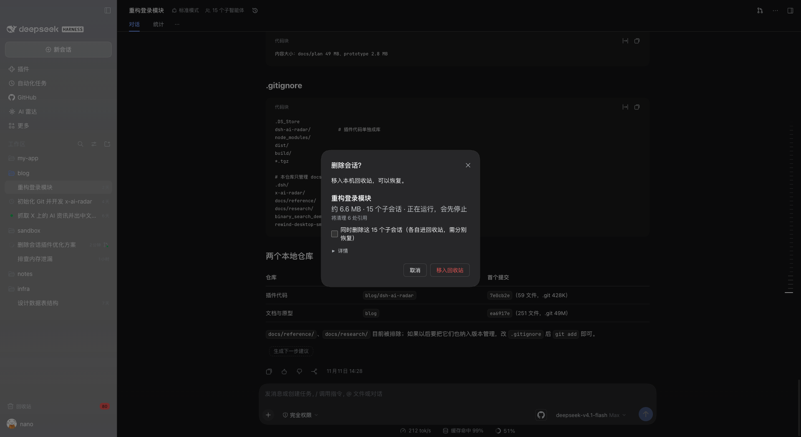
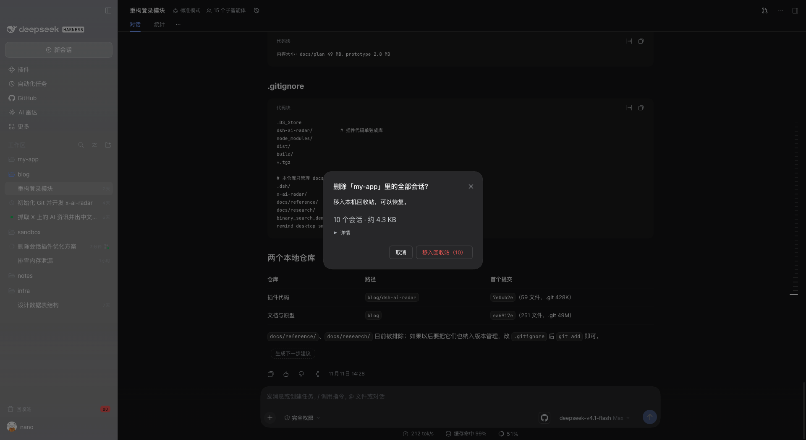
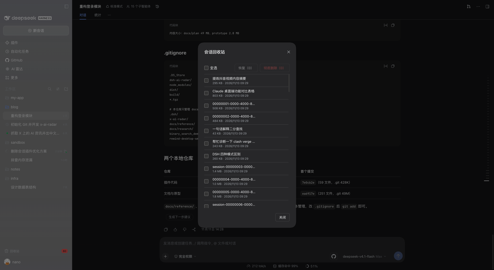
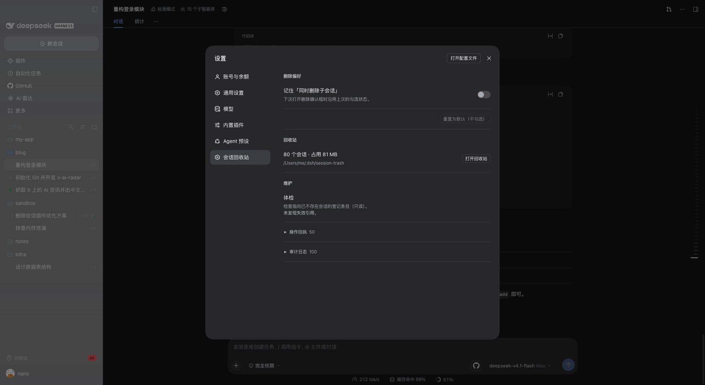

# @kangyishuai/dsh-session-delete

> 真正的删除会话：默认进回收站、删前先预演、留审计日志，删完给你一份残留回执。

[](https://www.npmjs.com/package/@kangyishuai/dsh-session-delete) [](#兼容性与降级) [](./LICENSE)

[English](./README.md)

非官方 [DeepSeek Harness (DSH)](https://github.com/deepseek-ai/deepseek-harness) 插件，与 DeepSeek 无关。

> **状态：早期可用。** 已在当前目标 DSH 版本上用 `pnpm smoke:session-delete`（临时 DSH home，33 项端到端断言）和 `pnpm probe:runtime` 验证；桌面只读回归是在更早的版本上做的。具体范围见[兼容性与降级](#兼容性与降级)表格。`pnpm gate session-delete` 一条命令跑完发版门禁。仍是年轻软件，重要数据请自行备份。




## 做什么

DSH 自带的「归档」只是把会话藏起来：id 记进工作区的归档集合，日志文件一直留在磁盘上。这个插件做真正的删除，并且把安全措施一起做了。

- **真正的删除。** 把会话目录从 `~/.dsh/sessions/` 移走，同时清掉还指向它的记账（归档集合、置顶集合、工作区归属、投影缓存），所以会话不会复活，也不会留下幽灵条目。
- **默认进回收站。** 第一次点删除不会抹掉任何东西：会话进 `~/.dsh/session-trash/`，随时可恢复。「彻底删除」是另一个独立的显式动作。
- **删前预演（plan / dry-run）。** 确认框由一份计划生成：占用体积、是否 live、有几个子会话、将清理哪些引用。真正执行前会重新算一遍并与你确认时的计划比对，不一致就中止，避免删掉你没看到的东西。
- **审计日志。** 每次删除 / 恢复 / 彻底删除都往 `~/.dsh/session-trash/audit.log` 追加一行 JSON，在 **设置 → 会话回收站** 里能直接看。
- **删除回执。** 移走之后核对会话可能被引用的几处，把没清干净的残留列出来（删除仍是一次一条；回收站列表支持批量恢复 / 批量彻底删除）。
- **快捷键与工作区批量。** `⌘⌥⌫`（可在 设置 → 通用 → 快捷键 改）对当前会话直接打开同一个确认框；工作区「…」菜单里多了 **删除此工作区的全部会话…**，先给出整组影响面，再逐条删除。
- **安静的界面。** 确认框只留一行「体积 · 子会话 · 正在运行」，技术细节收进「详情」；回收站是单页列表；体检、审计、回执搬到设置页。子会话的勾选沿用你上次的选择，存在宿主侧 `~/.dsh/session-trash/preferences.json`。

## 截图

| 删除确认                                                                                                                           | 工作区批量                                                                                                                            | 回收站                                                                                                                        | 设置 → 会话回收站                                                                                                                      |
| ---------------------------------------------------------------------------------------------------------------------------------- | ------------------------------------------------------------------------------------------------------------------------------------- | ----------------------------------------------------------------------------------------------------------------------------- | -------------------------------------------------------------------------------------------------------------------------------------- |
|  |  |  |  |

<sub>截图从真实 DSH 桌面版现场截取，并在 DOM 层把工作区名、会话标题、UUID 与本机用户路径替换为演示数据，不含真实内容。</sub>

## 安装

```bash
dsh plugin --profile desktop add @kangyishuai/dsh-session-delete
```

想跑本地工作区而不是发布版，必须先打包——`link:` 安装不行（宿主对 `@deepseek-ai/*` 的解析只覆盖真实路径位于 profile 内的包，符号链接会激活失败）：

```bash
cd packages/session-delete
pnpm pack --pack-destination /tmp
dsh plugin --profile desktop add /tmp/kangyishuai-dsh-session-delete-*.tgz
```

改完代码后重新 `pnpm pack` 并再次 `add`。

装完重启 DSH 桌面版。新装会加载 host 半，只刷新页面不够。

## 使用

**回收站内批量**：列表上方是吸顶的批量条（全选 / 批量恢复 / 批量彻底删除）。批量按 20 条一批执行，显示「处理中 n/总」，可随时「停止」——所以一次选 80 条也不会被宿主单次上限整单拒绝；失败的条目会汇总并保持选中，方便重试。

**Agent 工具**：模型可以调用 `session_delete`，但必须两段式——`action=plan` 返回影响面摘要和一次性 token（2 分钟有效），`action=delete` 必须带这个 token。它拒绝删除调用者自己的会话，会话在此期间变化会让 token 失效。通过 UI 删除不需要这个工具。

**键盘**：删除确认框打开时焦点就在「移入回收站」上，**回车即执行**、Esc 取消；不可删除时焦点回落到「取消」。Tab 在勾选框、详情折叠与按钮之间移动。`⌘/Ctrl + Alt + T` 直接打开回收站。因为级联勾选会被记住，回车离批量删除只有一步——所以确认框始终写明会带上多少个子会话。

**设置 → 会话回收站**：删除偏好（记住级联 / 重置为默认）、回收站概览（条目数、占用、路径），以及维护——体检（只动登记表）、操作回执、审计日志。

**刷新**：回收站面板没有刷新按钮——打开时自动加载，之后每 5 秒、窗口重新可见、以及每次恢复/彻底删除后自动同步。


入口都在侧栏的会话行上：

1. 打开会话的「…」菜单，选「删除会话…」。
2. 确认框会展示：
   - 这条会话在磁盘上占多少体积；
   - 会话是否 live（有没有在跑的轮次、子代理、后台任务）——live 会话会先被停下再删，而不是拒绝；
   - 有几个子会话，并给一个勾选框决定是否一并删除（默认不勾；每个子会话单独进回收站）；
   - 将被清理的引用：归档集合、置顶集合、工作区归属、投影缓存。
3. 确认。会话进入回收站，侧栏里的那一行消失。
4. 同一个菜单里的「回收站…」打开回收站面板，可以：
   - 看回收站里有什么（标题、体积、删除时间）；
   - **恢复**到侧栏；
   - **彻底删除**（不可恢复）；
   - 查看审计日志。

**体检**：回收站面板有第三个页签。它把会话存储与工作区记账对账，列出失效引用（归档/置顶幽灵、工作区记账、孤儿会话目录、损坏的回收站条目、未完成操作）。清理**只动登记表**，绝不删会话文件。

## 副作用与风险

会读写这些路径：

| 路径                                 | 操作                     | 说明                                                                                                                                                        |
| ------------------------------------ | ------------------------ | ----------------------------------------------------------------------------------------------------------------------------------------------------------- |
| `~/.dsh/sessions/<工作区>/<会话>/`   | 读 + 移动                | 通过宿主的持久化 seam（`stat` / `locate`）定位，不写死日志文件名。删除时整个会话目录移进回收站，恢复时移回来。同卷是 rename，跨卷退化为复制 + 校验 + 删除。 |
| `~/.dsh/storages/workspace.json`     | 只经宿主 API             | 归档 / 置顶集合与工作区归属通过 `workspaceRegistry` 的方法（archive、unarchive、pin、unpin、detachSession）改动，插件不会手改这个文件。                     |
| `~/.dsh/storages/session_projcache/` | 优先宿主 API，兜底读文件 | 清掉该会话的投影缓存，避免删掉的会话在搜索里冒出来。只有能力探测落在 internal 档时才直接碰文件。                                                            |
| `~/.dsh/session-trash/`              | 创建 + 写入              | 每条被删会话一个条目（带 `meta.json`），另有 `audit.log`（JSONL，一次操作一行）和 `journal/`（两阶段提交记录，用于下次启动时把中断的操作补完或回滚）。      |

- **不联网、不上报。**
- **macOS 窗口拖动。** 自绘确认框 fallback 的遮罩声明了 `data-window-drag-exclude`，覆盖页头时拖动不会拖走窗口。
- **默认可恢复。** 删除是把文件移走，不是抹掉。
- **彻底删除不可恢复。** 「彻底删除」以及清空回收站是真的删字节，没有撤销 toast，也找不回来。
- **恢复不等于完整撤销。** 日志和工作区归属会回来，置顶与归档标记不会：DSH 归档时会顺手清掉 pin，取消归档时不会恢复。
- **归档可能清理干净的工作树（DSH 0.2.2-rc.2 起）。** 「移入回收站」本质是归档会话：新版本 DSH 会记录会话创建的工作树，并在归档时对满足条件（没有未归档会话引用、Git 干净、不是分离 HEAD 等）的目录执行 `git worktree remove`。分支和提交保留，被忽略的文件（如 `node_modules`）不会保留。要保住检出目录，删除前用 `git worktree lock <path>`，或在 Forge 套件的 worktree 行打开 `retainOnArchive`。
- **卸载插件不会清空回收站。** `~/.dsh/session-trash/` 是你的恢复通道，会一直留着，除非你自己删。
- **数据根目录。** 按「插件配置 `dataRoot` → 环境变量 `DSH_HOME` → `~/.dsh`」的顺序解析。如果你的 DSH 把数据放在别处，要把插件指过去；根目录不像 DSH 数据目录时，插件会拒绝执行而不是瞎猜。
- **这是 alpha 软件，而且会动你的数据。** 它已在下方表格的版本上通过 GUI 验收，但仍属早期软件：重要会话请自行备份。

## 与官方归档的区别

归档是个书签，不是删除：DSH 只把会话 id 加进工作区的归档集合，磁盘上的东西原封不动，照样占空间、照样被索引。这个插件把文件从会话目录里移走、把指向它的记账清掉，同时在自己的回收站里留一份可恢复的副本，并记录做了什么。官方归档不受影响，照常可用——插件只是加了一个菜单项，没有替换任何东西。

## 兼容性与降级

本包没有声明 `engines.dsh` 版本范围，改用三层防线：

| 层            | 触发时机    | 做什么                                                 | 你会看到什么                                              |
| ------------- | ----------- | ------------------------------------------------------ | --------------------------------------------------------- |
| L1 版本闸门   | 安装 / 激活 | `engines.dsh` 版本范围。**未声明**，这一层目前不生效。 | 无                                                        |
| L2 启动自检   | 插件激活时  | 探测所有依赖的宿主能力。                               | 能力档位：`api` / `internal` / `minimal` / `unknown`      |
| L3 执行期拒绝 | 每次操作    | 每个操作自己再校验前置能力，unknown 一律拒绝。         | 结构化错误码 + 人类可读原因，磁盘上不会出现删了一半的状态 |

能力档位：

- `api` / `internal` —— 全流程可用。`internal` 表示部分步骤依赖不在公开文档里的宿主契约，会执行并在面板/回执里说明。
- `minimal` —— 宿主没有 `workspaceRegistry`（例如 headless 组合）。删除照常进行；归档闸门、置顶/工作区记账、投影缓存这些步骤被跳过并写进回执。
- `unknown` —— 持久化本体缺失：**只读模式**。plan、审计、回收站列表还能用；删除、恢复、彻底删除被禁用。

| 插件版本 | 已验证的 DSH 版本               | 说明                                                                                                                                                                                                                                                                                                                                                                    |
| -------- | ------------------------------- | ----------------------------------------------------------------------------------------------------------------------------------------------------------------------------------------------------------------------------------------------------------------------------------------------------------------------------------------------------------------------- |
| 0.5.0    | **0.2.2-rc.3**（桌面版）        | 这一版 DSH 不需要改代码。已验证：86 项单测 + `pnpm probe:runtime` 72/72 + web `pnpm smoke:session-delete` **33/33**（临时 DSH home）+ 桌面只读回归 **18/18**。                                                                                                                                                                                                          |
| 0.5.0    | **0.2.2-rc.2**（桌面版）        | 界面重构：确认框默认焦点落在「移入回收站」（回车即执行）、记忆「同时删除子会话」、回收站单页化并把审计/体检/回执迁到设置页、批量彻底删除按 20 条分批；会话菜单走官方 `contextMenus` 并新增 `⌘⌥⌫`、工作区菜单新增「删除此工作区的全部会话」。发版门禁 4 步全绿（verify / 探针 72 项 / web 冒烟 33 项 / 桌面只读回归 18 项），桌面回归在**发布产物 0.5.0** 上复跑 18/18。 |
| 0.4.9    | **0.2.2-rc.2**（桌面版）        | 回收站计数徽章的前景色改用配对 token：深色主题下 `state-error` 是浅红 `#f25a5a`，原先配写死白只有 3.29:1，配 `label-primary-foreground` 是 5.75:1（浅色仍 4.5:1）。新增 `test/client.test.js` 守住「token 必须真实存在 + 底色/前景成对」。桌面只读回归 14/14，单测 53。                                                                                                 |
| 0.4.8    | **0.2.2-rc.2**（桌面版）        | macOS 窗口拖动修复：自绘确认框 fallback 的遮罩声明 `data-window-drag-exclude`。桌面只读回归在发布版上复跑 14/14，宿主探针 67/67。                                                                                                                                                                                                                                       |
| 0.4.7    | **0.2.2-rc.2**（临时 DSH home） | `pnpm smoke:session-delete` 24/24（临时 DSH home）；此前 23/24 是冒烟把「新会话」临时行当成会话计数，修好行选择与按 ID 断言后全绿（见 [runtime 0.2.2-rc.2 §7](../../docs/runtime/0.2.2-rc.2.md)）。桌面只读回归跑在已装的 0.4.6 上（与 0.4.7 只差一处 Biome 模板字符串）：14/14。                                                                                       |
| 0.4.2    | **0.2.2-rc.1**（桌面版）        | `pnpm smoke:session-delete` 24 项断言全绿，并确认同一版本桌面版里插件正常激活、没有 bundle 错误。                                                                                                                                                                                                                                                                       |
| 0.4.2    | 0.2.1-rc.5（桌面版）            | `pnpm smoke:session-delete` 24 项断言全绿，并在同一版本桌面版做过人工 GUI 验收。                                                                                                                                                                                                                                                                                        |

目前只在 **macOS** 上验证过。Windows 相关路径（`session.lock` 的 EBUSY/EPERM 重试、宿主在那儿用的命名信号量）代码里有，但**还没实测**。

DSH 升级之后：重启，然后看插件的状态条（设置 → 插件）。如果显示只读模式，说明宿主 API 变了——升级插件，或者把两个版本号一起报上来，别硬用。

## 故障排查

| 症状                         | 大概率原因                                                       | 怎么办                                                           |
| ---------------------------- | ---------------------------------------------------------------- | ---------------------------------------------------------------- |
| 会话菜单里没有「删除会话…」  | client 半没加载：插件未激活，或菜单 slot 改名了                  | 看插件状态，确认插件已启用；装完要重启桌面版                     |
| 菜单项在，一点就提示只读模式 | L2 探测不到需要的宿主能力（DSH 升级后 API 变了）                 | 升级插件；升级后仍然只读，就带着状态输出和 DSH 版本提 issue      |
| 删除成功，但侧栏的行还在     | client 端的移除通道变了                                          | 刷新页面；刷新后还在，就带着 DSH 版本提 issue                    |
| 恢复后置顶 / 归档标记丢了    | DSH 归档时清 pin、取消归档时不恢复                               | 目前属预期行为；可以回回收站重试，日志本身没回来请提 issue       |
| 彻底删除后还残留东西         | 删除回执里列出的残留                                             | 对回执和审计日志，按回执里的路径手动清理，并把回执附在 issue 里  |
| 删完之后回收站是空的         | 插件解析到的数据根目录和你的 DSH 不是同一个（`DSH_HOME` / 配置） | 去磁盘上看 `~/.dsh/session-trash/`，再核对插件的 `dataRoot` 配置 |

## License

MIT，见 [LICENSE](./LICENSE)。本插件借鉴了若干社区项目的**设计**（不是代码），来源记在仓库的 [NOTICE](https://github.com/kangyishuai/dsh-plugins/blob/main/NOTICE)。
