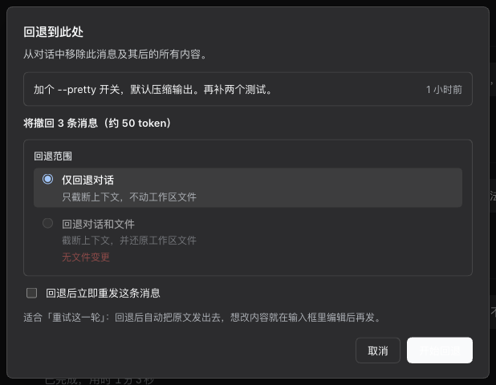
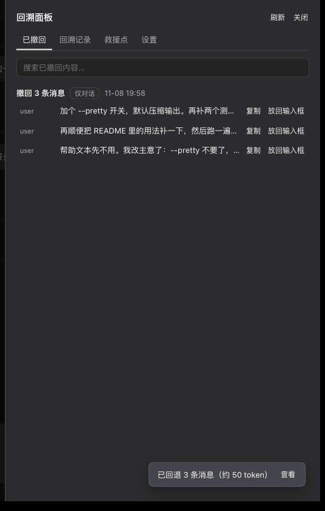

# @kangyishuai/dsh-session-rewind

> In-place conversation rewind for DeepSeek Harness: send the conversation back to before any user message, withdraw everything after it from the model context and the transcript, optionally restore the workspace files those turns changed, and put the message back into the composer.

[](https://www.npmjs.com/package/@kangyishuai/dsh-session-rewind) [](#compatibility) [](./LICENSE)

[中文](./README.zh-CN.md)

Unofficial plugin for [DeepSeek Harness (DSH)](https://github.com/deepseek-ai/deepseek-harness). Not affiliated with DeepSeek.

> **Status: early.** End to end verified against the current target DSH version — the [Compatibility](#compatibility) table records exactly what was run (unit tests, throwaway-home GUI suite, real-desktop read-only and `--recall` suites) and when. `pnpm gate:session-rewind` runs the whole release gate in one command. Young software — keep backups of anything you cannot lose.

## What it does

Long conversations drift. A few turns later you wish you had answered a prompt differently, but starting a new session loses everything before it, and continuing keeps the unwanted turns in the context window forever. This plugin rewinds **in place**:

- **Two entries.** Press `Esc` `Esc` to open the rewind dialog, or click the ↶ button in any user message's action row (next to Copy).
- **Running turns are not a dead end.** Confirming a rewind while a turn is running cancels that turn (keeping the queue), waits for it to go idle, then re-plans against the settled history.
- **State-change warnings.** If the withdrawn range changed session state that lives outside the transcript — plan mode, goal, todo list, model selection, permission/sandbox presets, agent preset, scheduled tasks, working directory — the dialog lists it and says that rewinding does not roll that state back.
- **Two scopes, chosen per rewind.** The confirmation dialog offers **Rewind conversation only** (default) and **Rewind conversation and files**. The dialog first shows a dry-run preview: how many messages and roughly how many tokens will be withdrawn, which files will be restored or moved to the trash (including how many deleted files will be recreated), conflicts, and skipped files grouped by reason. The dialog also spells out what is recoverable and focuses the primary button by default (the cancel button when the action cannot run); Tab stays inside it and focus returns to the trigger on close.
- **Conversation.** The target message and everything after it are withdrawn from the model-visible context and from the transcript. The session id, title and earlier history are untouched. Nothing is deleted from the log — one marker event is appended.
- **Files (optional).** Files changed by `write` / `edit` / `apply_patch` in the withdrawn turns are restored to their pre-change content, including files the agent deleted (they are recreated, parent directories included). Files created after the target are moved to the plugin's trash instead of deleted. A rescue point of the current files is created before anything is written; failures roll back from it. Rewinds can be repeated: each one is judged against the intended target state, so rewinding again to an earlier message is not blocked by the state an earlier rewind created.
- **Composer.** The target message's text (and images) is put back into the composer, ready to edit and send again. An existing draft is never overwritten. Tick **Send this message again right after rewinding** in the confirmation dialog to retry the turn in one click (conversation-only rewinds).
- **Prompt recall without rewinding.** In the composer, bare `↑` on an empty draft (or with the caret on the first line) recalls the last prompt you sent in this session — `↑` again walks further back, `↓` walks forward and restores the draft you had before browsing. It only replaces the draft text: nothing is withdrawn from the context, sent or rewritten. Toggle it in **Settings**.
- **Every view stays in sync.** Rewind in one tab or window and other open views of the same session hide the withdrawn rows immediately, without a reload (the notice travels through `localStorage`; the host's cuts remain the only source of truth).
- **Rewind panel.** A new header action opens a panel with three tabs: **Withdrawn** (every message each rewind removed, searchable, copy or put back in the composer), **History** (a timeline of each rewind and each rescue-point file restore, newest first: scope, message count, tokens, file results), and **Rescue points** (restore files from an earlier rescue).
- **Settings → Session rewind.** Default scope and the composer recall toggle on the first screen; page size, confirm-on-list and diagnostics live under **More settings** (collapsed by default). Diagnostics are localized (the host only returns keys/values) and report whether the read-only tool registered, plus data root and usage.

## Read-only agent tool

The plugin also registers one **read-only** tool, `session_rewind_candidates`, so the model can reason about rewinding without performing it:

| Call                                       | Result                                                                                                                                         |
| ------------------------------------------ | ---------------------------------------------------------------------------------------------------------------------------------------------- |
| `session_rewind_candidates {}`             | Newest-first list of messages this conversation can be rewound to (`query` filters, `limit` caps at 50).                                       |
| `session_rewind_candidates { target_seq }` | Impact preview for one message: how many messages would be withdrawn, whether an unfinished tool call would be truncated, and the target text. |

The tool never rewinds, never edits files and never appends to the session log — the rewind itself stays a user action (that is the point of the ADR 0006 design). Set `readOnlyTool: false` to unregister it; **Settings → Diagnostics** reports whether it registered.

## What it looks like





Both screenshots come from a throwaway DSH home containing only a synthetic workspace and session (`pnpm shots:session-rewind` regenerates them), cropped to the dialog and the panel.

> Image links are absolute (`raw.githubusercontent.com`) on purpose: npm does not ship `assets/` in the tarball, so a relative path would render as a broken image on npmjs.com.

## Install

```bash
dsh plugin --profile desktop add @kangyishuai/dsh-session-rewind
```

To run the working tree instead of a published version, pack it first — `link:` installs do not work (the host's `@deepseek-ai/*` resolution only covers packages whose real path is inside the profile):

```bash
cd packages/session-rewind
pnpm pack --pack-destination /tmp
dsh plugin --profile desktop add /tmp/kangyishuai-dsh-session-rewind-*.tgz
```

Re-run `pnpm pack` + `add` after changing the code. The plugin has a host half, so restart the DSH desktop app and refresh the page.

## Usage

**Keyboard — `Esc` `Esc`.** In an idle conversation, press Escape twice quickly. The rewind dialog lists user messages, newest first; search, page to older messages with ↑/↓, Enter or click to choose. Then the preview opens; pick a scope and confirm. While a turn is running, `Esc` `Esc` keeps its native meaning (stop the turn); press it again when idle.

**Message action — ↶.** Every user message has a ↶ button next to Copy. It opens the same preview/confirmation dialog. Nothing is rewound until you confirm.

**Commands.** Bare `/rewind` opens the plugin's own candidate dialog (the same one as `Esc` `Esc`: arrow keys move, Enter opens the confirmation, Esc closes, search filters). It lists only this session's rewindable messages — nothing is mixed in from composer history. `/rewind @<seq> [chat]` executes directly (conversation only). `/rewind @<seq> both` only prints the file impact first: it needs an explicit `confirm` token (`/rewind @<seq> both confirm`) before writing, and it refuses while the session is running — use the UI dialog in that case, since it stops the turn for you and shows the impact. `/rewind` is decorated by the client; the bare form never sends text to the model.

**Composer history — `↑` / `↓`.** Focus the composer and press `↑`: the newest prompt you sent in this session fills the draft; `↑` again walks further back, `↓` walks forward, and one more `↓` past the newest entry restores the draft you were typing. It works with an empty draft or when the caret sits on the first line — inside a multi-line draft on a later line the arrows keep moving the caret. Recall never rewinds, never sends and never writes to the session log. History covers the messages still in the model-visible surface (100 newest, older ones dropped) and excludes what an earlier rewind withdrew — those live in the panel's **Withdrawn** tab.

**After a rewind** the target text returns to the composer (images are re-attached best-effort) and the composer is focused. If the composer already held a draft, the draft is kept and a notice says so.

**What is refused**

| Situation                                                                                              | What happens                                                                                                                                                                                                                                   |
| ------------------------------------------------------------------------------------------------------ | ---------------------------------------------------------------------------------------------------------------------------------------------------------------------------------------------------------------------------------------------- |
| The session has a running turn                                                                         | It is cancelled first (queued steering messages are dropped), then the rewind runs. Set `cancelRunning: false` to refuse instead (`session-rewind/busy`).                                                                                      |
| The session is a subagent child                                                                        | No ↶ button and no `Esc` `Esc` dialog: the Harness refuses generic session RPCs there.                                                                                                                                                         |
| The target message was shadowed by compaction                                                          | Refused; the rewind boundary must still be in the model context.                                                                                                                                                                               |
| A file was changed or deleted outside the agent since the last recorded state                          | File mode is refused with a conflict list; no file is touched. Only files the agent itself deleted (or that an earlier rewind moved to the trash) are recreated. Content that matches a state this session recorded is not an external change. |
| A file is larger than 8 MiB, a symlink, a path outside the workspace, or under `.git` / `node_modules` | That file is recorded as skipped with its reason; the preview groups skipped files by reason and the success toast reports the count. Other files still proceed.                                                                               |
| A rewind is already running on this session                                                            | Refused; one at a time.                                                                                                                                                                                                                        |

## File restore scope & safety

- **Tracked changes only.** Only DSH file tools `write`, `edit` and `apply_patch` are tracked, and only under the session's working directory. Changes made by `bash`, scripts, external programs or subagents are **not** tracked; the plugin never claims a complete workspace snapshot.
- **Before every write.** The engine records the content before the tool runs, deduplicated by SHA-256 under `<DSH_HOME>/session-rewind/blobs/`. Before restoring, it compares the current state with the intended target state: files already at their pre-change content are left alone, files the agent deleted (or that an earlier rewind moved to the trash) are recreated, and anything else aborts the whole file operation with a conflict list — including a file the agent changed but something else deleted afterwards (`missing`).
- **Rescue before mutation.** All current affected files are copied to a rescue point first. If that fails, nothing is written. A failed restore rolls back applied files from the rescue point; failed rollbacks are reported. The five latest rescue points per session can be restored from the Rewind panel (a new rescue is created first).
- **Destructive operations go to trash.** Files created after the rewind target are moved to `<DSH_HOME>/session-rewind/trash/<session>/<auditId>/`, never `rm`'d. The Rewind panel's **Rescue points** tab lists the trash as well: a trash operation can be restored (a fail-closed safety rescue of the current files is created first — if it cannot be created, nothing is written) or permanently removed after an impact preview (file count/bytes, ADR 0002), with a `trash-clear` audit record. Note that this safety rescue only captures files that **exist at that moment**; recreating a file that was absent during the restore is not undone by restoring the safety rescue (that would require a reverse-trash step). (Restoring a file that an earlier rewind moved to the trash relies on that trash record still existing; trash entries are pruned by the retention policy below, after which such a file is reported as a `missing` conflict instead.) Files larger than 8 MiB, symlinks, paths outside the workspace and excluded trees are left alone, recorded as skipped with a reason, and counted in the preview and toast (the preview shows a skipped-only summary even when there is no restorable file).
- **Empty parent directories are reclaimed (disclosed side effect).** After a newly created file is moved to the trash, the plugin removes parent directories that became empty (bottom-up, `rmdir` only, never recursively, never the workspace root; it stops at the first non-empty directory). A pre-existing empty directory that received the created file is therefore also removed. `files.removedDirs` is recorded in the audit row; only directories, never data, are affected.
- **Write targets are canonicalized.** Restore, rescue-point restore, trash restore and rollback re-run the same path check as capture before each write: the parent directory is resolved with `realpath` and must stay inside the session working directory, and the target itself must not be a symlink. This closes the long windows (plan/preview → apply, panel restore days later). A directory swapped concurrently between the check and the write itself is outside the plugin's protection — this is defense in depth, not a sandbox.
- **Rewinds survive a restart.** The marker is a durable surface replacement, so the model context stays truncated after the DSH host restarts. The panel re-seeds the host's rewind history whenever a session opens (with bounded retries while the host resumes it), so withdrawn rows stay hidden in the transcript too. Verified against real logs with the host's surface fold; the live desktop-restart check is listed in `docs/testing/session-rewind.md` §2.7.
- **No undo.** This plugin deliberately does not implement conversation undo/redo (it would require patching DSH internals). The withdrawn content stays in the session log and the Rewind panel; file-level recovery is available through rescue points and the trash, both in the panel's **Rescue points** tab.
- **Order.** Preview and conflict checks run before anything is written; then the rescue point; then the conversation marker; then file writes. Once the marker is appended the conversation rewind stands even if file writes fail (they are reported and audited).

## Data & retention

All plugin data lives under `<DSH_HOME>/session-rewind/` (`DSH_HOME` defaults to `~/.dsh`):

| Path                            | Contents                                             |
| ------------------------------- | ---------------------------------------------------- |
| `blobs/`                        | content-addressed file contents (SHA-256)            |
| `sessions/<id>/entries.jsonl`   | per-session file change records (newest shown first) |
| `trash/<session>/<auditId>/`    | files created after a rewind target                  |
| `rescues/<session>/<rescueId>/` | rescue points (current files before a restore)       |
| `audit.jsonl`                   | one line per rewind (append-only)                    |

On startup the plugin also removes data for sessions that no longer exist (they were deleted; the audit log is kept) and collects blobs that no entry or manifest references any more (`gc-blobs` audit record; set `gcOnStartup: false` to skip). Cleanup only runs when the live sessions can be enumerated safely: the dry-run plan is written to the audit log first, and the plugin skips cleanup with a logged warning when enumeration finds no live session at all, when the session store does not look like `sessions/<workspace>/<session-id>/` (unknown layout — including a partial/mixed layout where a workspace has no recognizable session directory, or mixes in one that does not look like a session directory), or when any workspace is unreadable. It never treats "unknown" as "every record is an orphan", and plugin records it does not recognize are kept and logged (and counted in diagnostics). Retention: the 20 latest message anchors per session, the 5 latest rescue points, the 20 latest trash operations (30 days), and a 1 GiB soft cap across blobs/trash/rescues. When the cap is exceeded, old trash → old rescues → unreferenced blobs → oldest anchors are cleaned in that order; if still over the cap, new captures stop and diagnostics report it (no referenced data is deleted). Uninstalling keeps the data. The data root can be overridden with the plugin's `dataRoot` config. Restore-side reads are capped by the same 8 MiB single-file limit as capture: a tracked file grown past it is reported as `too-large` instead of being read into memory.

## Side effects & risks

- **Appends one marker event per rewind** to the current session log; nothing is deleted or rewritten.
- **Writes and deletes workspace files only in file mode**, after confirmation, with the safety described above.
- **The marker is visible to the model** as a short `(empty message)` user message where the withdrawn turns used to be. It is not shown in the transcript.
- **No network, no telemetry.** Everything is local; file snapshots may contain sensitive content, so treat `<DSH_HOME>/session-rewind/` like your workspace.
- **Private client seams.** Hiding rows and injecting the ↶ button rely on DSH's internal view/slot registries. They are shape-checked at install and degrade to “context rewound, transcript not hidden” or “button missing” rather than breaking a session.
- **Recall is a draft edit.** It fills the composer through the host facade, so `Ctrl+Z` steps back through recalls like any other draft change; it never appends to the session or the model context.
- **POSIX/macOS paths only** in this version; Windows separators and permission bits are not verified.
- **macOS overlays don't drag the window.** The drawer, its mask and the confirm dialog declare `data-window-drag-exclude`, so dragging over them while they cover the title bar behaves normally (verified with a real mouse drag on DSH 0.2.2-rc.2; earlier builds could drag the whole window).

## Compatibility

| DSH version | Status                                                                                                                                                                                                                                                                                                                                                                                     |
| ----------- | ------------------------------------------------------------------------------------------------------------------------------------------------------------------------------------------------------------------------------------------------------------------------------------------------------------------------------------------------------------------------------------------ |
| 0.2.2-rc.5  | **0.7.0** (2026-11-19): no code change needed for this DSH build. Verified: 208 unit tests + `pnpm probe:runtime` 72/72 + web `pnpm smoke:session-rewind` **52/52** (throwaway DSH home) + desktop read-only regression **25/25** (real Electron, this build). The host's client bundles and session format are byte-identical to rc.3 ([runtime rc.5](../../docs/runtime/0.2.2-rc.5.md)). |
| 0.2.2-rc.3  | **0.7.0** (2026-11-14): no code change needed for this DSH build. Verified: 208 unit tests + `pnpm probe:runtime` 72/72 + web `pnpm smoke:session-rewind` **52/52** (throwaway DSH home) + desktop read-only regression **25/25** (real Electron, this build).                                                                                                                             |
| 0.2.2-rc.2  | **0.7.0** (2026-11-14): settings moved to their own "Settings → Session rewind" section, drawer slimmed from 4 tabs to 3. Verified: 208 unit tests + `pnpm probe:runtime` 72/72 + web `smoke:session-rewind` **52/52** (throwaway DSH home) + desktop read-only regression **25/25** (real Electron, this build).                                                                          |
| 0.2.2-rc.1  | Verified 2026-11-09: 205 unit tests + web `smoke:session-rewind` 49/49 (temp DSH home) + desktop `smoke:session-rewind-desktop` 23/23 read-only, 30/30 with `--recall`, and 39/39 with `--deep` (file mode end to end, real Electron renderer over CDP); the full `--recall --deep` combination is 46/46.                                                                                  |

The plugin declares no `engines.dsh` and no `@deepseek-ai/*` peer range: DSH is pre-release and semver ranges over prereleases are unreliable (see [ADR 0005](../../docs/adr/0005-dsh-version-compatibility.md)). Treat the table as the compatibility statement. After a DSH upgrade run `pnpm probe:runtime`, `pnpm smoke:session-rewind`, and check the plugin's diagnostics tab; if a private seam changed, the plugin degrades instead of breaking the session.

## Development

```bash
pnpm test                     # unit tests (host engine, host RPC, client helpers)
pnpm verify                   # repo-wide gates
pnpm smoke:session-rewind           # temp DSH home + real GUI end-to-end (needs dsh & ego-browser)
pnpm smoke:session-rewind-desktop   # desktop (Electron) read-only check (24); --recall adds 7 composer-recall checks; --deep --workspace <dir> adds the file-mode run (40 total)
```

Design notes: [ADR 0006](../../docs/adr/0006-session-rewind-architecture.md) and [ADR 0007](../../docs/adr/0007-session-rewind-file-restore.md) (Chinese; the repository docs are written in Chinese).

## License

MIT
